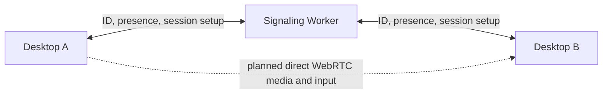

# SparkDesk

Account-free remote desktop for Windows, built in Rust. SparkDesk is designed around direct connections, clear session consent and a small signaling service that never relays screen video.

> **Status: early prototype.** The desktop shell, persistent device identity and optional signaling connection are implemented. Starting a remote session, viewing a screen and sending input are not available yet.

## What works today

- Native Slint desktop UI with keyboard-accessible icon buttons and Lucide SVG icons.
- Persistent Ed25519 device identity; the displayed ID is derived from the public key.
- Copy the device ID and view the current signaling connection status.
- Optional WebSocket connection to a signaling endpoint with challenge authentication and reconnect backoff.
- Cloudflare Worker and per-device Durable Objects for presence and session setup messages. The Worker builds locally but is not deployed.

The partner ID field is currently a UI placeholder: it does not initiate a session. Consent controls, WebRTC, screen capture, remote input, TURN relay, installer and real two-PC verification are still future work.

## Run the desktop

Requires Rust 1.92 or newer.

```powershell
cargo run -p sparkdesk-desktop
```

The app starts without a server and reports that signaling is not configured. To try the local signaling Worker, use two terminals:

```powershell
cd cloud/signaling
npm ci
npm run dev
```

```powershell
$env:SPARKDESK_SIGNALING_URL = "ws://127.0.0.1:8787"
cargo run -p sparkdesk-desktop
```

This only authenticates the device and shows it online; it does not enable remote control. Deployment requires a Cloudflare account and is not configured in this repository.

## Verify the build

```powershell
cargo fmt --all -- --check
cargo check --workspace --offline
cd cloud/signaling
npm ci
npm run build
```

## Architecture



The signaling service is for finding online devices and negotiating a session. The planned direct media path reduces latency and hosting cost, but without TURN relay some NAT and firewall combinations will not connect. No universal connectivity or frame-rate target is claimed before two-PC measurements.

## Project structure

```text
apps/desktop/       Rust desktop app, local identity and Slint UI
crates/protocol/    Versioned messages shared by Rust components
cloud/signaling/    TypeScript Worker and per-device Durable Object
docs/               Architecture and implementation plan
```

## Security and licensing

- A device ID helps locate a device; it is not an access credential.
- The intended product requires the remote owner to approve each session. Unattended access is out of scope.
- Screen content and input must stay on an encrypted peer connection; the signaling Worker must never relay them.
- This prototype does not yet provide a usable remote session. Do not expose it as a production remote-access service.
- Lucide icon license notices are included in `apps/desktop/ui/icons/LICENSE`.
- Review Slint distribution terms and attribution requirements before publishing an installer.

See [the architecture](docs/architecture.md) and [the ten-step roadmap](docs/superpowers/plans/2026-11-10-sparkdesk-foundation.md) for design details and progress.
