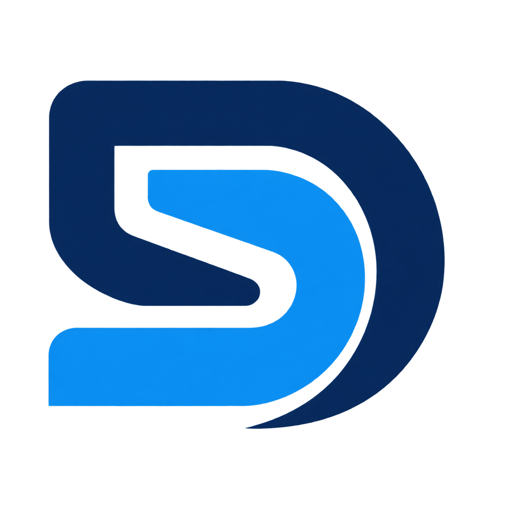
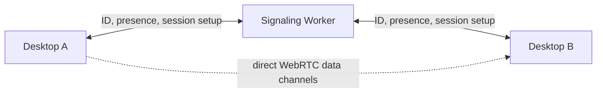

<p align="center"></p>

<h1 align="center">SparkDesk</h1>

<p align="center"><strong>Private remote support, with permission.</strong></p>

An account-free Windows remote-support prototype built with Rust, Tauri, React, and WebRTC. The device owner approves every session, grants mouse and keyboard control separately, and can revoke it while screen sharing continues.

> **Status: prototype.** The consent and remote-input flows are implemented. Two-device performance, 60 FPS, and cross-network connectivity still need real Windows testing.

## What works today

- Native Tauri desktop shell with a React interface built from Radix Themes controls and Lucide React icon components.
- Persistent Ed25519 device identity; the displayed ID is derived from the public key.
- Copy the device ID with the icon button or `Ctrl+Shift+C`; `Ctrl+L` focuses the partner ID field and `Enter` submits it.
- Send a connection request to an online device and require its owner to accept or decline.
- Negotiate a direct WebRTC connection after approval and provide a visible end-session action.
- Open each connected session in its own resizable window while keeping the home window available. Closing the session window ends the session.
- Stream the primary display directly to the connected device. The host separately enables mouse and keyboard control and can revoke it without stopping screen viewing.
- Show the viewer's canvas draw rate and rolling p95 input-dispatch round trip in the session toolbar.
- Run a second local instance with a separate profile, for example `--profile=helper`.
- Switch the home screen between Russian and English without restarting.
- View the current signaling connection status.
- Optional WebSocket connection to a signaling endpoint with challenge authentication and reconnect backoff.
- Cloudflare Worker and per-device Durable Objects for presence and setup messages. A temporary public Worker is available for connection testing.

The capture loop is scheduled at 60 Hz, but actual 60 FPS and low-latency targets are not yet verified on two Windows PCs; JPEG encoding, rendering and network conditions can reduce the observed rate. TURN relay, installer and real two-PC verification remain future work. Without TURN, some NAT/firewall combinations will not connect.

## Run the desktop

Requires Rust 1.92 or newer, Node.js 20.19+ and npm.

```powershell
cd apps/desktop/ui-react
npm ci
$env:SPARKDESK_SIGNALING_URL = "wss://sparkdesk-signaling.obtainable-bloom.workers.dev"
npm run tauri -- dev
```

To test two instances on one Windows PC, leave the first one running and start the second executable directly (this reuses the first window's Vite server):

```powershell
$env:SPARKDESK_SIGNALING_URL = "ws://127.0.0.1:8787"
cd apps/desktop/ui-react
Start-Process (Resolve-Path "..\..\..\target\debug\sparkdesk-desktop.exe") -ArgumentList "--profile=helper"
```

The second instance has its own device identity. Connect from one window to the ID shown in the other, accept the request on the host, and enable control there only when needed.

The example endpoint is a temporary Cloudflare deployment and may expire. To run your own signaling Worker, use two terminals:

```powershell
cd cloud/signaling
npm ci
npm run dev
```

```powershell
$env:SPARKDESK_SIGNALING_URL = "ws://127.0.0.1:8787"
cd apps/desktop/ui-react
npm run tauri -- dev
```

For two PCs over the public internet, deploy the Worker from `cloud/signaling` with `npm run deploy`, then set the URL on both clients:

```powershell
$env:SPARKDESK_SIGNALING_URL = "wss://sparkdesk-signaling.<your-account>.workers.dev"
cd apps/desktop/ui-react
npm run tauri -- dev
```

Both devices must be online at once. The Worker coordinates requests only; screen frames and input travel directly over WebRTC data channels.

## Verify the build

```powershell
cargo fmt --all -- --check
cargo check --workspace --offline
npm --prefix apps/desktop/ui-react ci
npm --prefix apps/desktop/ui-react run build
cd cloud/signaling
npm ci
npm run build
```

## Architecture



The signaling service is for finding online devices and negotiating a session. The direct path avoids relaying data through the Worker, but without TURN some NAT and firewall combinations will not connect. No universal connectivity or frame-rate target is claimed before two-PC measurements.

## Project structure

```text
apps/desktop/                         Rust/Tauri desktop application
  capabilities/                       Window permissions
  icons/                              Windows application and installer icons
  src/
    identity.rs                       Ed25519 device identity and peer proofs
    input.rs                          Validated remote mouse and keyboard input
    main.rs                           Tauri commands, app state and session window
    peer.rs                           WebRTC data channels and peer authentication
    screen.rs                         Windows capture, JPEG frames and reassembly
    signaling.rs                      Consent flow and signaling connection
  Cargo.toml, tauri.conf.json         Native app dependencies and configuration
  ui-react/
    public/                            App brand assets
    src/
      styles/                          UI styles by surface
      ui/
        components/                    Header, connection, session and viewer UI
        App.tsx, copy.ts, types.ts     App state, translations and UI types
crates/protocol/src/lib.rs              Versioned signaling messages
cloud/signaling/src/index.ts            TypeScript Worker and per-device Durable Object
docs/
  branding/                            Logo concepts and visual direction
  superpowers/
    plans/                              Implementation roadmaps
    specs/                              Feature and behavior specifications
  architecture.md                      System architecture
```

## Security and licensing

- A device ID helps locate a device; it is not an access credential.
- The intended product requires the remote owner to approve each session. Unattended access is out of scope.
- Screen content and input must stay on an encrypted peer connection; the signaling Worker must never relay them.
- This prototype has not had a real two-PC/NAT traversal review. Do not expose it as a production remote-access service.
- Review Tauri, Radix Themes and Lucide licensing and attribution requirements before publishing an installer.

See [the architecture](docs/architecture.md) and [the ten-step roadmap](docs/superpowers/plans/2026-11-10-sparkdesk-foundation.md) for design details and progress.
